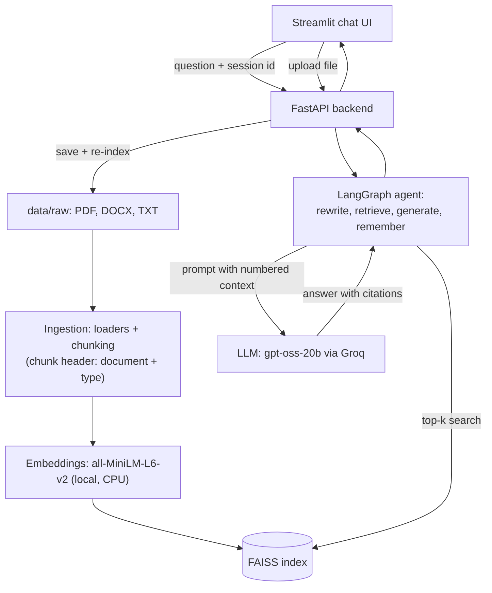

# Procurement AI Assistant (RAG + LangChain)

Ask questions about your **contracts, supplier manuals and policy documents** in plain English
and get answers that are **grounded in the documents and cite their sources**. If the answer is not in
the documents, the assistant says so instead of guessing.

**Tech stack:** Python, LangChain, LangGraph, FAISS, Hugging Face sentence-transformers,
Groq API (open-source `gpt-oss-20b`; OpenAI / Hugging Face supported as options), FastAPI, Streamlit, Docker, pytest

## Features

- **Citation-backed answers**: every answer carries `[n]` markers and a list of the source passages it used
- **Refuses instead of hallucinating**: "I could not find this in the provided documents." for out-of-scope questions
- **Conversation memory** (LangGraph): follow-ups like "And what is the cap on that?" are rewritten into a standalone question
- **PDF, DOCX and TXT** documents, organised by type (contracts, policies, supplier manuals)
- **Upload from the UI**: new files are saved and the FAISS index is rebuilt and hot-swapped without a restart
- **Runs locally with one command** (Docker Compose); embeddings run on the CPU, no GPU needed
- **Tested**: 40+ pytest tests, including a small retrieval evaluation (12 questions, top-3 hit rate)

## Screenshots

| Chat with citations | Upload documents |
|---|---|
|  |  |

## Quick start (Docker)

1. Install Docker Desktop and get a free API key at [console.groq.com](https://console.groq.com)
2. Copy `.env.example` to `.env` and put your key in `GROQ_API_KEY`
3. Run:

```
docker compose up --build
```

- Chat UI: http://localhost:8501  |  API docs: http://localhost:8000/docs
- First build takes several minutes (torch CPU + the embedding model); later starts are fast
- Your documents and the FAISS index live in `./data`; if the index is missing, the API container builds it on start
- Stop with `Ctrl+C`, or `docker compose down`; `.env` is never copied into the images

Example questions for the included sample documents:

- "Who needs to approve a purchase of $20,000?"
- "What is the penalty if Acme delivers late?" then "And what is the cap on that?"
- "What on-time delivery does Globex guarantee?"
- "Within how many hours must a data breach be reported?"
- "What is the capital of France?" (answer: not found in the documents)

All sample documents are synthetic (invented) and contain no real company data.

## Architecture



How a question flows: the agent rewrites follow-ups into a standalone question (using the chat memory), FAISS
returns the most similar chunks, the LLM answers **only** from those numbered chunks, and the API returns the answer
together with the sources that were actually cited.

## Project Structure

```
procurement-ai-assistant/
├── src/
│   ├── config.py                 # central settings (env-driven)
│   ├── ingestion/
│   │   ├── loaders.py            # PDF/DOCX/TXT -> LangChain Documents (doc_type from folder name)
│   │   └── chunking.py           # recursive splitting + contextual chunk header
│   ├── embeddings/embedder.py    # local HF sentence-transformers
│   ├── vectorstore/
│   │   ├── faiss_store.py        # build / save / load / search FAISS index
│   │   └── indexer.py            # save uploaded files, rebuild + hot-swap the index
│   ├── rag/                      # llm.py (Groq/HF/OpenAI), prompts.py, chain.py
│   ├── agent/graph.py            # LangGraph: rewrite -> retrieve -> generate -> remember
│   └── api/main.py               # FastAPI: /health, /query, /upload, /documents
├── streamlit_app/app.py          # chat UI
├── docker/                       # Dockerfile.api, Dockerfile.ui, requirements-api/ui.txt
├── docker-compose.yml            # runs API + UI together
├── tests/                        # pytest suite (see "Run the tests")
├── data/
│   ├── raw/                      # source documents: contracts/, policies/, supplier_manuals/
│   └── processed/                # FAISS index lives here (git-ignored)
├── docs/screenshots/             # README images
├── requirements.txt
└── .env.example
```

## Local setup (Anaconda + VS Code)

Install in **stages**. One big `pip install -r requirements.txt` can look
stuck for 10+ minutes because torch is ~2 GB and pip's resolver is slow.

```bash
# 0. Activate the env you made in Anaconda Navigator
conda activate procurement-ai

# 1. Update pip (fixes many slow-resolver problems)
python -m pip install --upgrade pip

# 2. PyTorch CPU-only (small, no GPU needed)
pip install torch --index-url https://download.pytorch.org/whl/cpu

# 3. Embeddings + vector store
pip install sentence-transformers faiss-cpu

# 4. LangChain + document loaders
pip install langchain langchain-community langchain-huggingface langchain-openai langgraph pypdf docx2txt python-docx

# 5. Config + backend + UI
pip install pydantic pydantic-settings python-dotenv huggingface-hub fastapi "uvicorn[standard]" streamlit

# 6. Copy the env file (Windows: copy .env.example .env)
cp .env.example .env
```

If a step looks stuck: press `Ctrl + C`, then re-run that same step with
`-v` (e.g. `pip install -v sentence-transformers`) to see what it is doing.

## Run the pipeline step by step

```bash
# Test document loading
python -m src.ingestion.loaders

# Test chunking
python -m src.ingestion.chunking

# Test embeddings (downloads all-MiniLM-L6-v2 on first run, ~80MB)
python -m src.embeddings.embedder

# Full pipeline: load -> chunk -> embed -> build FAISS index -> search
python -m src.vectorstore.faiss_store
```

---

## Run the tests

```
pip install pytest httpx
python -m pytest -q
```

- `tests/test_loaders.py`, `test_chunking.py`, `test_rag_helpers.py`: pure unit tests (no network, no models)
- `tests/test_api.py`: FastAPI endpoints with the agent replaced by a fake (no API key needed)
- `tests/test_agent_graph.py`: LangGraph memory + query rewriting with a fake LLM and fake index
- `tests/test_upload.py`: upload endpoint (type/size/path-traversal checks) and index rebuild with fakes
- `tests/test_retrieval.py`: small retrieval evaluation (12 questions over the sample documents, top-3 hit rate >= 80%) on the sample documents with the real embedding model; skipped if sentence-transformers is not installed
- `pytest.ini` sets the project root as import path, so run pytest from the project root

## Roadmap

- [x] Project scaffold, config, requirements, sample data
- [x] Document ingestion: multi-format loaders (PDF/DOCX/TXT) + metadata tagging
- [x] Text chunking with clause-aware recursive splitting
- [x] Embedding generation (Hugging Face sentence-transformers, local/CPU)
- [x] FAISS vector store: build, persist, load, similarity search
- [x] Environment setup confirmed on user's machine (4 smoke tests pass)
- [x] RAG chain: retriever + prompt template + LLM, with `[n]` citations and "not found" refusal
- [x] LangGraph agent: conversational memory (MemorySaver per session_id) + query rewriting
- [x] FastAPI backend: `/health`, `/query` (verified); `/upload`, `/documents` (verified in the UI)
- [x] Streamlit chat UI (calls the API, shows sources and "Understood as: ...")
- [x] Dockerfiles + docker-compose for API + UI (verified: `docker compose up --build`, chat UI works on localhost:8501)
- [x] Tests (pytest) for ingestion, retrieval, API, agent, upload (all passing on the user's PC)
- [x] Retrieval evaluation: 12 sample questions, top-3 hit rate (inside the pytest suite)
- [x] Contextual chunk headers (document name + type embedded with every chunk)
- [ ] Screenshots in `docs/screenshots/` + upload to GitHub (+ optional GitHub Actions CI)
- [ ] Delete-document endpoint
- [ ] Migrate off `langchain-community` (harmless "being sunset" warning for now)

---

## Session Log

### Session 1 — Project Kickoff & Ingestion Pipeline
- Scaffolded full project structure (`src/`, `streamlit_app/`, `data/`, `docker/`, `tests/`)
- Added `requirements.txt` with pinned versions for the whole stack
- Added `src/config.py` — pydantic-settings based config, reads from `.env`
- Built `src/ingestion/loaders.py` — loads PDF/DOCX/TXT, infers `doc_type`
  (contract/policy/supplier_manual) from folder structure, tags metadata
  for later citations
- Built `src/ingestion/chunking.py` — recursive character splitting tuned
  for contract/policy prose, preserves metadata + adds `chunk_id`
- Added sample synthetic procurement policy + contract docs under
  `data/raw/` so the pipeline is testable without real company data
- Decided: LLM provider = Hugging Face / Llama 3 (no OpenAI key
  available), documents = synthetic samples for now

### Session 2 — Embeddings & FAISS Vector Store
- Set `LLM_PROVIDER=huggingface` as the default in config and `.env.example`
- Built `src/embeddings/embedder.py` — local `all-MiniLM-L6-v2` on CPU
  (no paid API calls, keeps documents off third-party APIs)
- Built `src/vectorstore/faiss_store.py` — `build_index()`, `save_index()`,
  `load_index()`, `similarity_search()`; index persists to
  `data/processed/faiss_index/` (gitignored)

### Session 3 — Setup troubleshooting
- `pip install -r requirements.txt` hung for ~10 min on the user's machine
- Cause: heavy packages (`unstructured`, torch via `sentence-transformers`)
  plus strictly pinned versions made pip's resolver very slow
- Fix: removed `unstructured`, loosened version pins in `requirements.txt`
  (added `docx2txt`, which `Docx2txtLoader` needs), and switched the
  README setup to a staged install (torch CPU first, then the rest)
- Note: the earlier zip had to be rebuilt after a workspace reset; the
  project content is unchanged apart from the files above
- **Next session:** confirm all 4 smoke tests pass, then build the RAG
  chain (retriever + prompt + Llama 3 via Hugging Face)

### Session 4 — LLM provider fix, RAG chain, API, UI, LangGraph
- Hugging Face inference did not work on the free account (`check_llm` failed
  for all candidate models; Llama 3 gave `400 model_not_supported`)
- Switched LLM provider to **Groq** (free tier, OpenAI-compatible API) via
  `ChatOpenAI` with Groq's `base_url`; the account lists no Llama models, so
  `GROQ_MODEL=openai/gpt-oss-20b` is used (`max_tokens=2048` for reasoning models)
- Verified `python -m src.rag.chain`: correct cited answers for in-document
  questions and the correct "I could not find this in the provided documents."
  refusal for an out-of-scope question
- Added `src/api/main.py` (FastAPI `/health`, `/query`; sources carry a `cited` flag) — verified
- Added `streamlit_app/app.py` (chat UI calling the API) — verified
- Added `src/agent/graph.py` (LangGraph: rewrite -> retrieve -> generate ->
  remember, MemorySaver keyed by `session_id`); `/query` now goes through
  `run_agent`, UI sends a uuid per chat — verified with `python -m src.agent.graph`
- Note: chunks are sent to Groq's servers (fine for synthetic docs; revisit for real documents)
- **Next session:** Dockerfiles + docker-compose (API + UI), then pytest,
  `/upload` endpoint, more synthetic docs

### Session 5 — Docker
- Installed Docker Desktop on Windows (WSL 2); hit "This app can't run on your PC" (wrong installer) and a 500 error
  from the engine (engine not started / WSL needed update); `docker run hello-world` works now
- Added `docker/Dockerfile.api` (python:3.10-slim, torch CPU, embedding model baked in at build time,
  builds the FAISS index on first start if missing), `docker/Dockerfile.ui` (Streamlit only, small image),
  `docker-compose.yml` (api on 8000, ui on 8501, `./data` mounted, ui waits for the API health check),
  `.dockerignore`, per-image requirements files, and refreshed `.env.example` (Groq defaults)
- First build failed at the torch step: the old pip in `python:3.10-slim` could not read the PyTorch CPU index
  (`inconsistent Name` + `flit_core` not found). Fix: `pip install --upgrade pip` before installing torch
- Status: rebuild OK; UI opened at localhost:8501, backend status green, answers with citations work
- **Next session:** confirm the Docker build, then pytest, `/upload` endpoint, more synthetic docs

### Session 5 (continued) — Docker verified, pytest suite
- Docker rebuild succeeded; chat UI on http://localhost:8501 works, sidebar green, cited answers returned
- Added `pytest.ini` and 5 test files in `tests/` (26 tests): loaders, chunking, RAG helpers + prompt,
  API (health, query, validation, 503/500 paths), LangGraph memory/rewriting, retrieval hit rate
- In my sandbox 25 passed and 1 (retrieval) was skipped because sentence-transformers was not installed;
  the retrieval test runs on the user's machine
- Note: `pytest` and `httpx` were not part of the staged local install, so run `pip install pytest httpx` first
- **Next session:** run the tests, then `/upload` endpoint + Streamlit upload widget, more synthetic docs

### Session 5 (continued) — pytest passed, /upload endpoint
- User ran the suite: `26 passed in 164s` (slow part = loading torch + the embedding model)
- Added `POST /upload` (multipart file + `doc_type`: contracts | policies | supplier_manuals) and `GET /documents`
- New `src/vectorstore/indexer.py`: safe file name (no path tricks), allowed types pdf/docx/txt, 10 MB limit,
  saves to `data/raw/<doc_type>/`, re-indexes the whole corpus and hot-swaps the new FAISS index into the running
  chain (no restart); a lock stops two uploads from rebuilding at the same time
- Streamlit sidebar: document type picker, file uploader, "Upload & index" button, list of indexed documents
- New dependency `python-multipart` (needed by FastAPI for file uploads) in `requirements.txt` and `docker/requirements-api.txt`
- Added `tests/test_upload.py` (14 tests); in my sandbox 39 passed + 1 skipped (retrieval skipped, no sentence-transformers)
- Status: NOT yet run by the user. Docker needs a rebuild (`docker compose up --build`) for the new package
- **Next session:** verify upload in the UI, then more synthetic docs (supplier manual, a PDF, second contract) + extend the retrieval eval set

### Session 5 (continued) — upload verified, richer sample documents
- User ran `python -m pytest -q`: `40 passed`; upload in the Streamlit sidebar worked and the new document was answered with a citation
- Tip: after a UI update, if Streamlit only shows grey loading boxes, hard-refresh with `Ctrl + Shift + R` (browser cache)
- Added 3 synthetic documents (all invented, nothing real): `data/raw/supplier_manuals/supplier_manual.txt`,
  `data/raw/contracts/supplier_agreement_globex.docx` (tests the DOCX loader),
  `data/raw/policies/vendor_risk_policy.pdf` (tests the PDF loader) -> corpus is now 5 documents / 12 chunks
- Retrieval evaluation grown from 5 to 12 questions (top-3 hit rate >= 80%)
- Re-index after adding files by hand: delete `data/processed/faiss_index`, then `docker compose restart api`
  (or upload any file in the UI, which re-indexes everything)
- **Next session:** confirm the new documents are answered correctly, then cleanup (langchain-community imports, config defaults), optional CI, README screenshots, resume bullets
- Troubleshooting: if `pytest` fails with `The paging file is too small (os error 1455)`, Windows is out of memory
  (usually Docker Desktop is running at the same time). Stop Docker (`docker compose down`, quit Docker Desktop,
  `wsl --shutdown`) and run the tests again

### Session 5 (continued) — all 40 tests green, config cleanup
- After stopping Docker (memory), `python -m pytest -q` -> `40 passed` including the 12-question retrieval evaluation on the 6 documents
- `src/config.py` defaults now match the real setup (`LLM_PROVIDER=groq`, `GROQ_MODEL=openai/gpt-oss-20b`); `.env` still overrides them
- Known limitation: `langchain-community` prints a "being sunset" DeprecationWarning. It is harmless today; the pipeline
  (FAISS vector store + document loaders) still works, so the migration to standalone packages is postponed on purpose.
  Hidden in pytest output through `pytest.ini`
- **Next session:** README polish with screenshots, GitHub upload (+ optional GitHub Actions CI), resume bullets

### Session 5 (continued) — contextual chunk headers (fix for a missed DOCX answer)
- Bug seen in the UI: "What on-time delivery does Globex guarantee?" -> "I could not find this in the provided documents"
  (TXT and PDF questions worked). With top-k = 8 the answer (98%) appeared, so the DOCX WAS indexed but ranked too low:
  the chunk holding "98% on-time" does not contain the word "Globex" (only the first chunk of that contract does)
- Fix: every chunk now starts with a header line `[Document: <file> | Type: <doc_type>]` before embedding
  (`src/ingestion/chunking.py`); `strip_context_header()` hides it again in the LLM context and in the UI snippets (`src/rag/chain.py`)
- Tests: 3 new chunking tests + 1 RAG-helper test (sandbox: 43 passed, 1 skipped)
- The index MUST be rebuilt after this change (old index has no headers): upload any file in the UI, or delete
  `data/processed/faiss_index`; Docker also needs `docker compose up --build` because the code is baked into the image
- **Next session:** verify the Globex question at the default top-k = 4, then screenshots / GitHub upload / resume bullets

### Session 5 (continued) — header fix verified, README rewritten for GitHub
- The Globex question now answers (98%) at the default top-k = 4 after the contextual chunk-header fix
- README top part rewritten as a portfolio page: features, screenshots table, Docker quick start, example questions,
  Mermaid architecture diagram (renders on GitHub), accurate tech stack (Groq `gpt-oss-20b`, no longer "GPT-4 / Llama 3")
- The old Docker section moved into "Quick start"; setup/pipeline sections renamed "Local setup" / "Run the pipeline step by step"
- Screenshots are referenced as `docs/screenshots/chat.png` and `upload.png`; they must be added before pushing to GitHub
- `.gitignore` already contains `.env` and `data/processed/faiss_index/` (checked), so the Groq key will not be uploaded
- **Next session:** add screenshots, create the GitHub repository and push (step by step), optional CI, resume bullets
- User confirmed `python -m pytest -q` -> `44 passed`; screenshots `chat.png` and `upload.png` added to `docs/screenshots/`
- GitHub push started (repository creation, `git init`, safety check that `.env` is not tracked)
