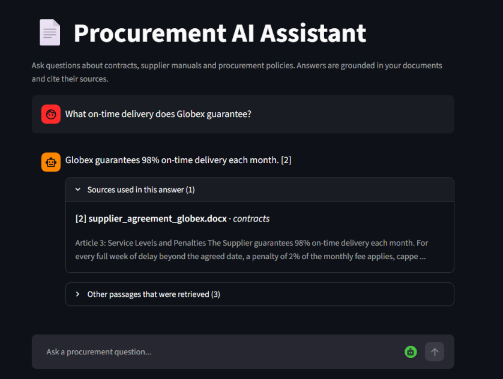
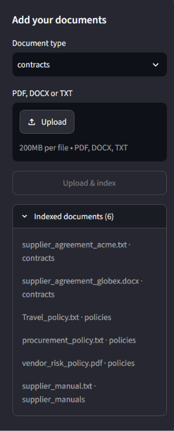
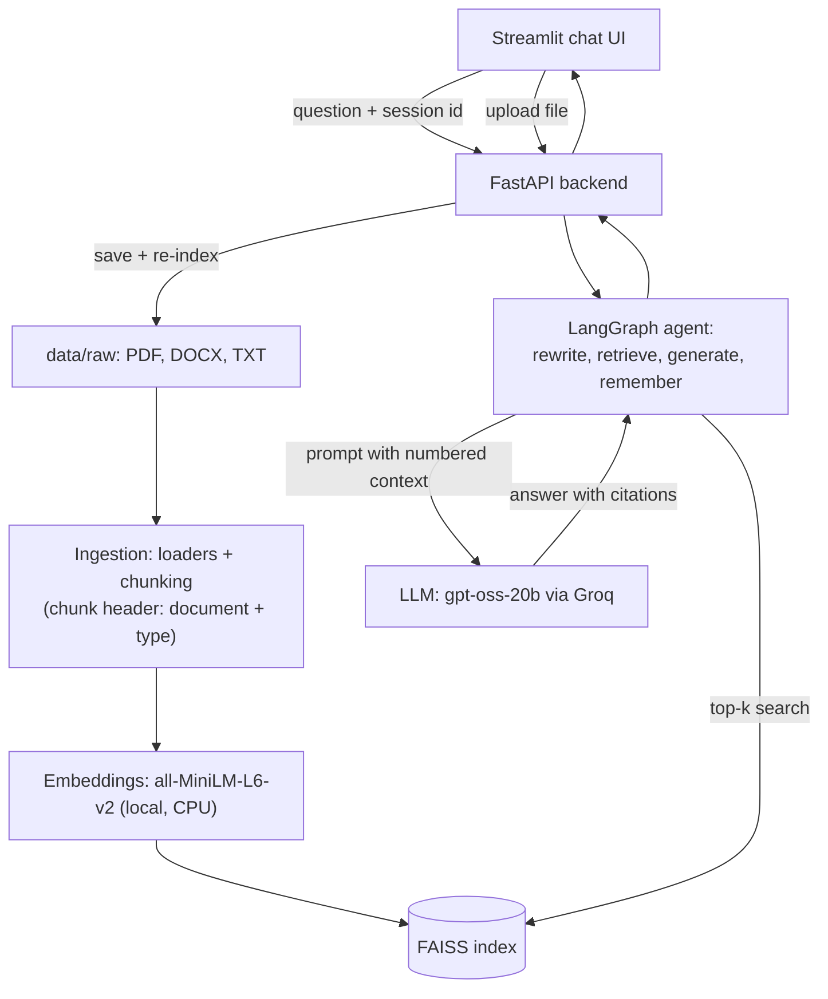

# Procurement AI Assistant (RAG + LangChain)

Ask questions about your **contracts, supplier manuals and policy documents** in plain English
and get answers that are **grounded in the documents and cite their sources**. If the answer is not in
the documents, the assistant says so instead of guessing.

**Tech stack:** Python, LangChain, LangGraph, FAISS, Hugging Face sentence-transformers,
Groq API (open-source `gpt-oss-20b`; OpenAI / Hugging Face supported as options), FastAPI, Streamlit, Docker, pytest

## Features

- **Citation-backed answers**: every answer carries `[n]` markers and a list of the source passages it used
- **Refuses instead of hallucinating**: "I could not find this in the provided documents." for out-of-scope questions
- **Conversation memory** (LangGraph): follow-ups like "And what is the cap on that?" are rewritten into a standalone question
- **PDF, DOCX and TXT** documents, organised by type (contracts, policies, supplier manuals)
- **Upload from the UI**: new files are saved and the FAISS index is rebuilt and hot-swapped without a restart
- **Runs locally with one command** (Docker Compose); embeddings run on the CPU, no GPU needed
- **Tested**: 40+ pytest tests, including a small retrieval evaluation (12 questions, top-3 hit rate)

## Screenshots

| Chat with citations | Upload documents |
|---|---|
|  |  |

## Quick start (Docker)

1. Install Docker Desktop and get a free API key at [console.groq.com](https://console.groq.com)
2. Copy `.env.example` to `.env` and put your key in `GROQ_API_KEY`
3. Run:

```
docker compose up --build
```

- Once the containers are running, open the chat UI at `http://localhost:8501` and the API docs at `http://localhost:8000/docs` in your browser
  (these addresses only work on the computer that is running the project; there is no public demo link)
- First build takes several minutes (torch CPU + the embedding model); later starts are fast
- Your documents and the FAISS index live in `./data`; if the index is missing, the API container builds it on start
- Stop with `Ctrl+C`, or `docker compose down`; `.env` is never copied into the images

Example questions for the included sample documents:

- "Who needs to approve a purchase of $20,000?"
- "What is the penalty if Acme delivers late?" then "And what is the cap on that?"
- "What on-time delivery does Globex guarantee?"
- "Within how many hours must a data breach be reported?"
- "What is the capital of France?" (answer: not found in the documents)

All sample documents are synthetic (invented) and contain no real company data.

## Architecture



How a question flows: the agent rewrites follow-ups into a standalone question (using the chat memory), FAISS
returns the most similar chunks, the LLM answers **only** from those numbered chunks, and the API returns the answer
together with the sources that were actually cited.

## Project Structure

```
procurement-ai-assistant/
├── src/
│   ├── config.py                 # central settings (env-driven)
│   ├── ingestion/
│   │   ├── loaders.py            # PDF/DOCX/TXT -> LangChain Documents (doc_type from folder name)
│   │   └── chunking.py           # recursive splitting + contextual chunk header
│   ├── embeddings/embedder.py    # local HF sentence-transformers
│   ├── vectorstore/
│   │   ├── faiss_store.py        # build / save / load / search FAISS index
│   │   └── indexer.py            # save uploaded files, rebuild + hot-swap the index
│   ├── rag/                      # llm.py (Groq/HF/OpenAI), prompts.py, chain.py
│   ├── agent/graph.py            # LangGraph: rewrite -> retrieve -> generate -> remember
│   └── api/main.py               # FastAPI: /health, /query, /upload, /documents
├── streamlit_app/app.py          # chat UI
├── docker/                       # Dockerfile.api, Dockerfile.ui, requirements-api/ui.txt
├── docker-compose.yml            # runs API + UI together
├── tests/                        # pytest suite (see "Run the tests")
├── data/
│   ├── raw/                      # source documents: contracts/, policies/, supplier_manuals/
│   └── processed/                # FAISS index lives here (git-ignored)
├── docs/screenshots/             # README images
├── requirements.txt
└── .env.example
```

## Local setup (Anaconda + VS Code)

Install in **stages**. One big `pip install -r requirements.txt` can look
stuck for 10+ minutes because torch is ~2 GB and pip's resolver is slow.

```bash
# 0. Activate the env you made in Anaconda Navigator
conda activate procurement-ai

# 1. Update pip (fixes many slow-resolver problems)
python -m pip install --upgrade pip

# 2. PyTorch CPU-only (small, no GPU needed)
pip install torch --index-url https://download.pytorch.org/whl/cpu

# 3. Embeddings + vector store
pip install sentence-transformers faiss-cpu

# 4. LangChain + document loaders
pip install langchain langchain-community langchain-huggingface langchain-openai langgraph pypdf docx2txt python-docx

# 5. Config + backend + UI
pip install pydantic pydantic-settings python-dotenv huggingface-hub fastapi "uvicorn[standard]" streamlit

# 6. Copy the env file (Windows: copy .env.example .env)
cp .env.example .env
```

If a step looks stuck: press `Ctrl + C`, then re-run that same step with
`-v` (e.g. `pip install -v sentence-transformers`) to see what it is doing.

## Run the pipeline step by step

```bash
# Test document loading
python -m src.ingestion.loaders

# Test chunking
python -m src.ingestion.chunking

# Test embeddings (downloads all-MiniLM-L6-v2 on first run, ~80MB)
python -m src.embeddings.embedder

# Full pipeline: load -> chunk -> embed -> build FAISS index -> search
python -m src.vectorstore.faiss_store
```

---

## Run the tests

```
pip install pytest httpx
python -m pytest -q
```

- `tests/test_loaders.py`, `test_chunking.py`, `test_rag_helpers.py`: pure unit tests (no network, no models)
- `tests/test_api.py`: FastAPI endpoints with the agent replaced by a fake (no API key needed)
- `tests/test_agent_graph.py`: LangGraph memory + query rewriting with a fake LLM and fake index
- `tests/test_upload.py`: upload endpoint (type/size/path-traversal checks) and index rebuild with fakes
- `tests/test_retrieval.py`: small retrieval evaluation (12 questions over the sample documents, top-3 hit rate >= 80%) on the sample documents with the real embedding model; skipped if sentence-transformers is not installed
- `pytest.ini` sets the project root as import path, so run pytest from the project root

## Roadmap

- [x] Project scaffold, config, requirements, sample data
- [x] Document ingestion: multi-format loaders (PDF/DOCX/TXT) + metadata tagging
- [x] Text chunking with clause-aware recursive splitting
- [x] Embedding generation (Hugging Face sentence-transformers, local/CPU)
- [x] FAISS vector store: build, persist, load, similarity search
- [x] Environment setup confirmed on user's machine (4 smoke tests pass)
- [x] RAG chain: retriever + prompt template + LLM, with `[n]` citations and "not found" refusal
- [x] LangGraph agent: conversational memory (MemorySaver per session_id) + query rewriting
- [x] FastAPI backend: `/health`, `/query` (verified); `/upload`, `/documents` (verified in the UI)
- [x] Streamlit chat UI (calls the API, shows sources and "Understood as: ...")
- [x] Dockerfiles + docker-compose for API + UI (verified: `docker compose up --build`, chat UI works on localhost:8501)
- [x] Tests (pytest) for ingestion, retrieval, API, agent, upload (all passing on the user's PC)
- [x] Retrieval evaluation: 12 sample questions, top-3 hit rate (inside the pytest suite)
- [x] Contextual chunk headers (document name + type embedded with every chunk)
- [x] Screenshots in `docs/screenshots/` + uploaded to GitHub
- [ ] Optional: GitHub Actions CI
- [ ] Delete-document endpoint
- [ ] Migrate off `langchain-community` (harmless "being sunset" warning for now)

---

## Session Log

### Session 1 — Project Kickoff & Ingestion Pipeline
- Scaffolded full project structure (`src/`, `streamlit_app/`, `data/`, `docker/`, `tests/`)
- Added `requirements.txt` with pinned versions for the whole stack
- Added `src/config.py` — pydantic-settings based config, reads from `.env`
- Built `src/ingestion/loaders.py` — loads PDF/DOCX/TXT, infers `doc_type`
  (contract/policy/supplier_manual) from folder structure, tags metadata
  for later citations
- Built `src/ingestion/chunking.py` — recursive character splitting tuned
  for contract/policy prose, preserves metadata + adds `chunk_id`
- Added sample synthetic procurement policy + contract docs under
  `data/raw/` so the pipeline is testable without real company data
- Decided: LLM provider = Hugging Face / Llama 3 (no OpenAI key
  available), documents = synthetic samples for now

### Session 2 — Embeddings & FAISS Vector Store
- Set `LLM_PROVIDER=huggingface` as the default in config and `.env.example`
- Built `src/embeddings/embedder.py` — local `all-MiniLM-L6-v2` on CPU
  (no paid API calls, keeps documents off third-party APIs)
- Built `src/vectorstore/faiss_store.py` — `build_index()`, `save_index()`,
  `load_index()`, `similarity_search()`; index persists to
  `data/processed/faiss_index/` (gitignored)

### Session 3 — Setup troubleshooting
- `pip install -r requirements.txt` hung for ~10 min on the user's machine
- Cause: heavy packages (`unstructured`, torch via `sentence-transformers`)
  plus strictly pinned versions made pip's resolver very slow
- Fix: removed `unstructured`, loosened version pins in `requirements.txt`
  (added `docx2txt`, which `Docx2txtLoader` needs), and switched the
  README setup to a staged install (torch CPU first, then the rest)
- Note: the earlier zip had to be rebuilt after a workspace reset; the
  project content is unchanged apart from the files above
- **Next session:** confirm all 4 smoke tests pass, then build the RAG
  chain (retriever + prompt + Llama 3 via Hugging Face)

### Session 4 — LLM provider fix, RAG chain, API, UI, LangGraph
- Hugging Face inference did not work on the free account (`check_llm` failed
  for all candidate models; Llama 3 gave `400 model_not_supported`)
- Switched LLM provider to **Groq** (free tier, OpenAI-compatible API) via
  `ChatOpenAI` with Groq's `base_url`; the account lists no Llama models, so
  `GROQ_MODEL=openai/gpt-oss-20b` is used (`max_tokens=2048` for reasoning models)
- Verified `python -m src.rag.chain`: correct cited answers for in-document
  questions and the correct "I could not find this in the provided documents."
  refusal for an out-of-scope question
- Added `src/api/main.py` (FastAPI `/health`, `/query`; sources carry a `cited` flag) — verified
- Added `streamlit_app/app.py` (chat UI calling the API) — verified
- Added `src/agent/graph.py` (LangGraph: rewrite -> retrieve -> generate ->
  remember, MemorySaver keyed by `session_id`); `/query` now goes through
  `run_agent`, UI sends a uuid per chat — verified with `python -m src.agent.graph`
- Note: chunks are sent to Groq's servers (fine for synthetic docs; revisit for real documents)
- **Next session:** Dockerfiles + docker-compose (API + UI), then pytest,
  `/upload` endpoint, more synthetic docs

### Session 5 — Docker, tests, uploads, sample documents, GitHub

**Built**
- **Docker:** `docker/Dockerfile.api` (python:3.10-slim, torch CPU, embedding model baked in at build time, builds the FAISS
  index on first start if missing), `docker/Dockerfile.ui` (Streamlit only), `docker-compose.yml` (API on 8000, UI on 8501,
  `./data` mounted, UI waits for the API health check), `.dockerignore`, per-image requirements, refreshed `.env.example` (Groq defaults)
- **Tests:** `pytest.ini` + 6 test files in `tests/` (44 tests): loaders, chunking, RAG helpers and prompt, API, LangGraph
  memory/rewriting, upload, and a 12-question retrieval evaluation (top-3 hit rate >= 80%)
- **Upload:** `POST /upload` and `GET /documents`; new `src/vectorstore/indexer.py` (safe file names, pdf/docx/txt only,
  10 MB limit, re-indexes the whole corpus and hot-swaps the new FAISS index into the running chain, lock against parallel uploads);
  Streamlit sidebar with type picker, file uploader and list of indexed documents; new dependency `python-multipart`
- **Sample documents** (all invented): `supplier_manual.txt`, `supplier_agreement_globex.docx`, `vendor_risk_policy.pdf`
- **Contextual chunk headers:** every chunk starts with `[Document: <file> | Type: <doc_type>]` before embedding;
  `strip_context_header()` hides it again in the LLM context and the UI snippets
- **Config:** `src/config.py` defaults now match the real setup (`groq`, `openai/gpt-oss-20b`; `.env` still overrides them)
- **README:** rewritten as a portfolio page (features, screenshots, Docker quick start, Mermaid architecture, example questions)
- **GitHub:** pushed to https://github.com/priyansh212/procurement-ai-assistant

**Problems hit and fixes**
- Docker installer "This app can't run on your PC" -> wrong installer type; `500 Internal Server Error` from the engine -> engine not started / `wsl --update`
- First image build failed at the torch step (old pip could not read the PyTorch CPU index) -> `pip install --upgrade pip` first
- Streamlit showed only grey loading boxes after a UI update -> browser cache, fixed with `Ctrl + Shift + R`
- `pytest` retrieval test failed with `The paging file is too small (os error 1455)` -> Windows out of memory while Docker Desktop was running; stop Docker (`docker compose down`, quit Docker Desktop, `wsl --shutdown`) before running the tests
- The Globex question ("What on-time delivery does Globex guarantee?") said "not found" at top-k 4 but worked at top-k 8: the chunk with
  the answer did not contain the word "Globex" -> fixed with the chunk headers (rebuild the index and the Docker image after such a change:
  upload any file in the UI or delete `data/processed/faiss_index`, then `docker compose up --build`)
- `git push` failed with "Password authentication is not supported" -> removed the stale `git:https://github.com` entry in Windows Credential Manager
- README `localhost` links do not work for GitHub visitors (localhost is their own PC) -> shown as plain text with a note

**Known limitation:** `langchain-community` prints a "being sunset" DeprecationWarning. It is harmless today (FAISS store and
document loaders still work), so the migration to standalone packages is postponed; the warning is hidden in pytest through `pytest.ini`.

**Next:** GitHub About description + topics, resume bullets with the repo link, optional GitHub Actions CI, optional delete-document endpoint
